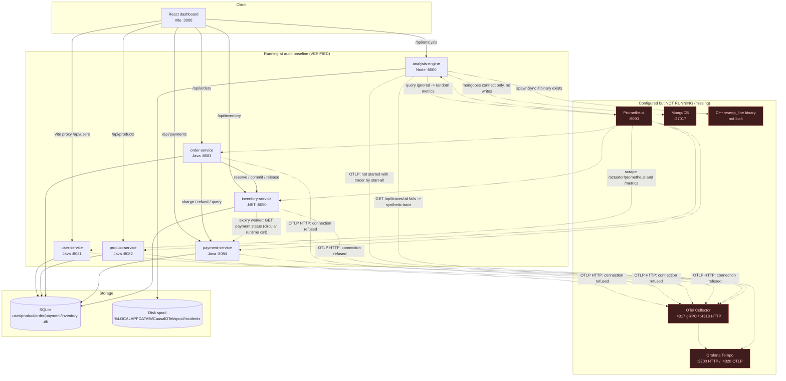
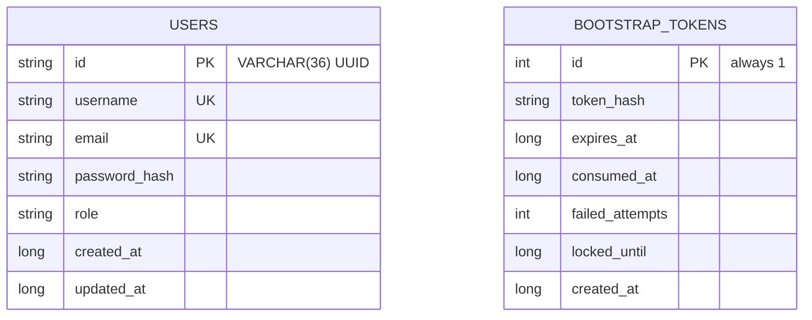
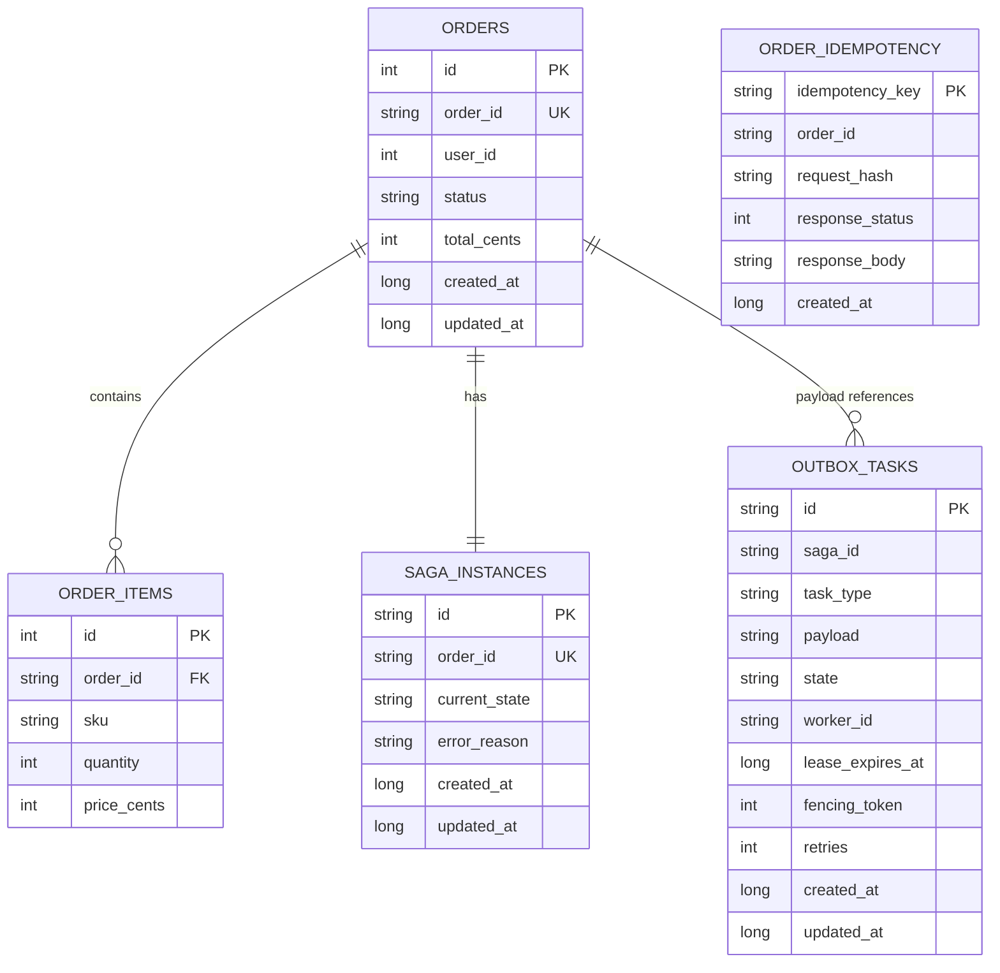
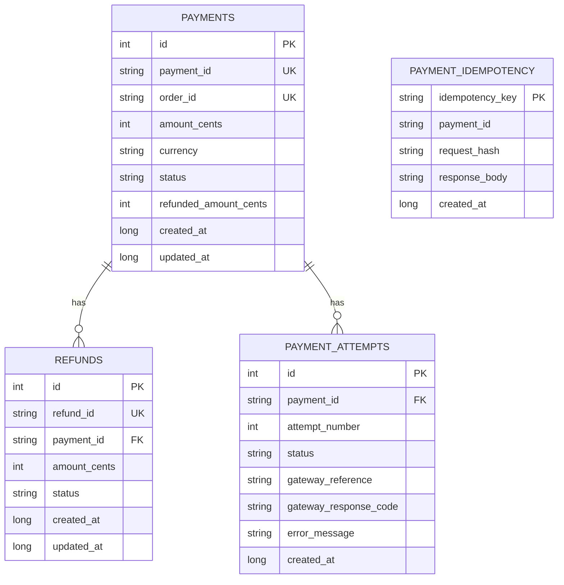
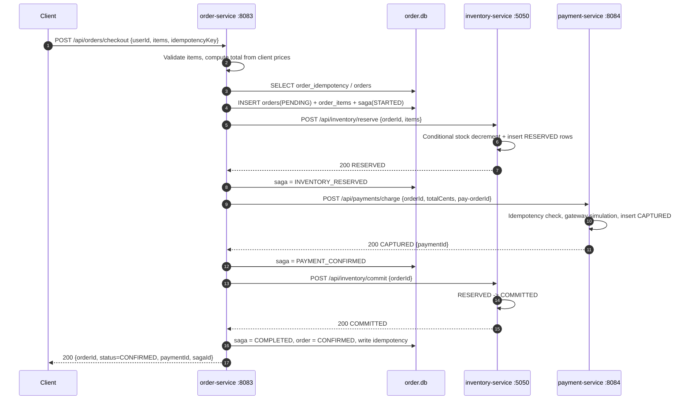
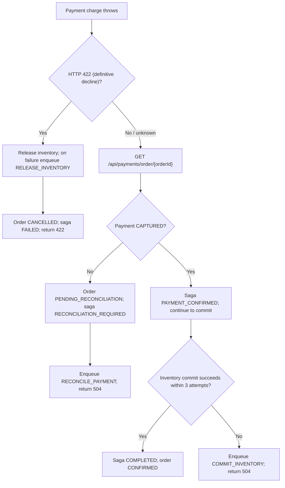
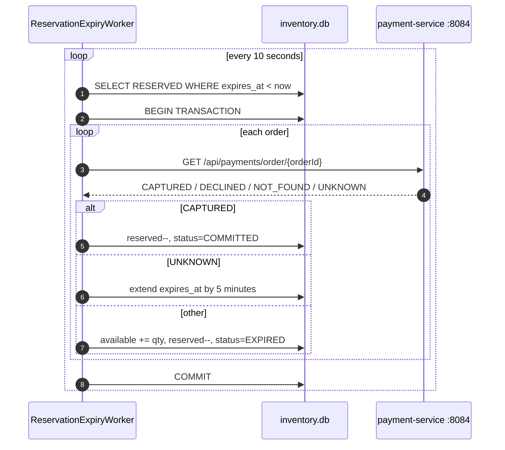
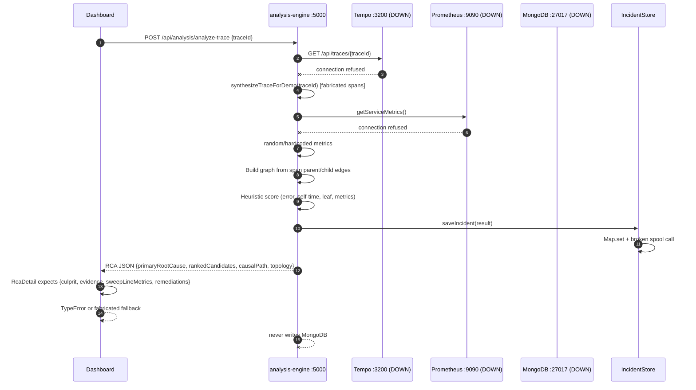
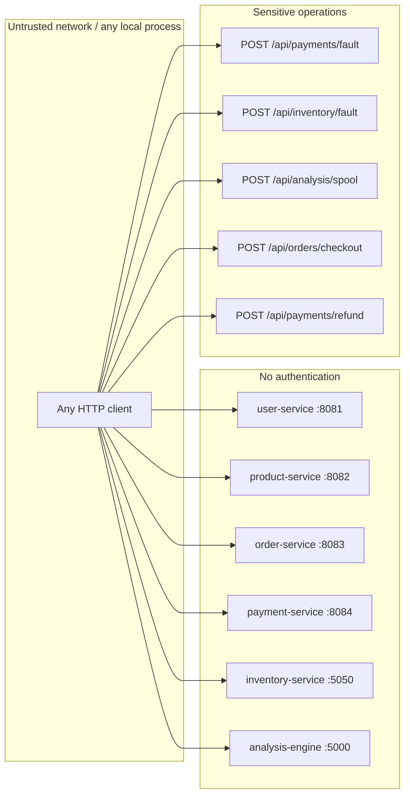

# ARCHITECTURE — CausalOTel

> Implemented architecture at audit baseline `a10bf0b` (2026-11-11). This document describes what the
> code actually does, including components that are configured but **not running** and data paths that
> are advertised but **not implemented**. Status labels: **IMPLEMENTED**, **VERIFIED**,
> **PARTIALLY IMPLEMENTED**, **PLANNED**, **UNVERIFIED**. Findings are detailed in
> [`AUDIT_REPORT.md`](AUDIT_REPORT.md); run/test context is in [`PROJECT_CONTEXT.md`](PROJECT_CONTEXT.md).

## 1. System context

CausalOTel is a local polyglot e-commerce demo with an observability/RCA sidecar:

- **Business plane:** user, product, order, payment, and inventory services.
- **Analysis plane:** a Node.js analysis engine and a React dashboard.
- **Telemetry plane (intended):** OpenTelemetry Collector → Tempo for traces; Prometheus for metrics.
- **Persistence:** one SQLite database per business service, plus an in-memory incident store and a
  disk spool in the analysis engine. MongoDB is configured but not used.

At the audit baseline the business plane and dashboard were running; the entire telemetry plane was
not. The analysis engine therefore served synthetic traces, random metrics, and a static graph. See
§7.

## 2. Runtime topology



**Port summary:** `3000` dashboard, `8081` user, `8082` product, `8083` order, `8084` payment,
`5050` inventory, `5000` analysis. `4317`, `4318`, `4320`, `8889`, `9090`, and `3200` were closed at
the audit baseline.

## 3. Service and API catalog

### 3.1 user-service — Java/Spring Boot, port 8081

| Method | Path | Purpose | Status |
|---|---|---|---|
| GET | `/api/users` | List users | IMPLEMENTED, **broken for UUID rows** (reads `id` as `int`) |
| GET | `/api/users/{id}` | Get user by integer id | IMPLEMENTED, **contract mismatch** with `VARCHAR(36)` schema |
| POST | `/api/users/bootstrap-admin` | One-time admin provisioning with `X-Bootstrap-Token` | IMPLEMENTED |
| GET | `/health/live`, `/health/ready`, `/health` | Health probes | IMPLEMENTED |
| GET | `/actuator/prometheus` | Micrometer metrics | IMPLEMENTED |

Data: `user.db` (`users`, `bootstrap_tokens`). Admin bootstrap generates a 256-bit token, stores only
its SHA-256 hash, writes the raw token to
`%LOCALAPPDATA%\CausalOTel\security\.bootstrap_admin_token`, and deletes the file after successful
consumption. Passwords are BCrypt cost 12.

### 3.2 product-service — Java/Spring Boot, port 8082

| Method | Path | Purpose |
|---|---|---|
| GET | `/api/products` | List catalog |
| GET | `/api/products/{sku}` | Get product by SKU |
| GET | `/health/live`, `/health/ready`, `/health` | Health probes |
| GET | `/actuator/prometheus` | Metrics |

Data: `product.db` (`products`). Flyway V2 seeds four SKUs, including `SKU-LAPTOP-001` and a
zero-stock `SKU-OUT-OF-STOCK-004`.

### 3.3 order-service — Java/Spring Boot, port 8083

| Method | Path | Purpose |
|---|---|---|
| POST | `/api/orders/checkout` | Execute checkout saga |
| POST | `/api/orders/{orderId}/reconcile` | Manually reconcile an indeterminate order |
| GET | `/api/orders` | List orders |
| GET | `/api/orders/{orderId}` | Get order |
| GET | `/api/orders/{orderId}/items` | Get order items |
| GET | `/api/orders/{orderId}/saga` | Get saga state |
| GET | `/api/orders/outbox` | List recent outbox tasks |
| GET | `/health/live`, `/health/ready` | Health probes |
| GET | `/actuator/prometheus` | Metrics |

Data: `order.db` (`orders`, `order_items`, `saga_instances`, `outbox_tasks`, `order_idempotency`).
The checkout request body is `{userId, items:[{productId, sku, quantity, priceCents}],
idempotencyKey}`. **Prices and totals come from the client** (AUDIT_REPORT C-02).

### 3.4 payment-service — Java/Spring Boot, port 8084

| Method | Path | Purpose |
|---|---|---|
| GET | `/api/payments` | List payments |
| GET | `/api/payments/{paymentId}` | Get payment by payment id |
| GET | `/api/payments/order/{orderId}` | Get payment by order id (reconciliation) |
| POST | `/api/payments/charge` | Charge (idempotent) |
| POST | `/api/payments/refund` | Refund with cumulative invariant |
| POST | `/api/payments/fault` | Set simulated latency/fault mode |
| GET | `/api/payments/fault` | Read simulated fault state |
| GET | `/health/live`, `/health/ready` | Health probes |
| GET | `/actuator/prometheus` | Metrics |

Data: `payment.db` (`payments`, `refunds`, `payment_idempotency`, `payment_attempts`, plus
`payments.refunded_amount_cents`). Fault modes: `NORMAL`, `LATENCY`, `DECLINED` (422),
`GATEWAY_TIMEOUT` (504), `GATEWAY_DOWN` (503). Simulation is enabled by default and fails closed when
a `prod`/`production` profile is active.

### 3.5 inventory-service — .NET/ASP.NET Core, port 5050

| Method | Path | Purpose |
|---|---|---|
| GET | `/api/inventory` | List stock items |
| GET | `/api/inventory/{sku}` | Get stock by SKU |
| POST | `/api/inventory/reserve` | Reserve stock for an order |
| POST | `/api/inventory/commit` | Commit a reservation |
| POST | `/api/inventory/release` | Release a reservation |
| POST | `/api/inventory/fault` | Set simulated latency/busy/error |
| GET | `/api/inventory/fault` | Read fault state |
| GET | `/health/live`, `/health/ready`, `/health` | Health probes |
| GET | `/metrics` | OpenTelemetry Prometheus exporter |

Data: `inventory.db` (`stock_items`, `stock_reservations`) created with `EnsureCreated()`, not
migrations. A background `ReservationExpiryWorker` scans expired `RESERVED` rows every 10 seconds and
calls payment-service to decide whether to commit, extend, or expire.

### 3.6 analysis-engine — Node.js/Express, port 5000

| Method | Path | Purpose | Actual behavior |
|---|---|---|---|
| GET | `/health/live` | Liveness | Always UP |
| GET | `/health/ready` | Readiness | **503** unless MongoDB is connected |
| GET | `/metrics` | Prometheus metrics | Process metrics only |
| GET | `/api/analysis` | Baseline contract | Pending spool file count |
| GET | `/api/analysis/incidents` | List incidents | In-memory `Map` only |
| GET | `/api/analysis/incidents/:id` | Incident detail | In-memory `Map` only |
| POST | `/api/analysis/analyze-trace` | Analyze a trace | Tempo fetch or synthetic fallback |
| GET | `/api/analysis/graph` | Dependency graph | **Static** 7-node topology |
| GET | `/api/analysis/metrics` | Service metrics | **Random/hardcoded** |
| POST | `/api/analysis/spool` | Spool incident | Writes disk file; path traversal risk |

### 3.7 dashboard — React/Vite, port 3000

| Route | Component | Data source | Actual behavior |
|---|---|---|---|
| `/` | `Overview.jsx` | static + checkout POST | Static health/KPIs; live checkout button |
| `/services` | `Services.jsx` | static | Every service shown `ONLINE` |
| `/graph` | `DependencyGraph.jsx` | `GET /api/analysis/graph` | Static graph; payment node always red |
| `/traces` | `Traces.jsx` | static mock | Four hardcoded traces |
| `/traces/:traceId` | `TraceDetail.jsx` | `POST /api/analysis/analyze-trace` | Response ignored; hardcoded waterfall |
| `/incidents` | `Incidents.jsx` | `GET /api/analysis/incidents` | Fabricated fallback incidents |
| `/rca`, `/rca/:incidentId` | `RcaDetail.jsx` | `GET /api/analysis/incidents/:id` | Expects an older/different schema |
| `/metrics` | `Metrics.jsx` | `GET /api/analysis/metrics` | Expects array; keeps mock array |
| `/fault-injection` | `FaultInjection.jsx` | fault endpoints | Sends wrong payload shape |
| `/settings` | `Settings.jsx` | static + direct probes | Reports UP on probe failure |

Vite proxies `/api/users`, `/api/products`, `/api/orders`, `/api/payments`, `/api/inventory`, and
`/api/analysis` to the corresponding service.

## 4. Data model

### 4.1 user.db



The controller reads `users.id` with `ResultSet.getInt` and accepts `@PathVariable int id`, which
does not match the UUID column (AUDIT_REPORT M-04).

### 4.2 product.db

`products(id, sku UNIQUE, name, description, price_cents, stock_quantity, created_at, updated_at)`.
Four seed rows are inserted by Flyway V2.

### 4.3 order.db



Order and saga IDs are deterministic: `ord-`/`saga-` plus the first 16 hex characters of
`SHA-256(idempotencyKey)`. The idempotency `request_hash` is
`SHA-256(userId:totalCents:itemCount)`, not a hash of the full item payload (AUDIT_REPORT H-03).

### 4.4 payment.db



`payments.order_id` is unique, so a second successful charge for the same order cannot be inserted.
Refunds enforce `already_refunded + requested <= captured` in a transaction and a conditional update.

### 4.5 inventory.db

`stock_items(product_id PK, sku UNIQUE, available_quantity, reserved_quantity, updated_at)` and
`stock_reservations(id PK, order_id, sku, quantity, status, expires_at, created_at, updated_at)`.
There is **no unique constraint on `(order_id, sku)`**. Reservation uses a conditional SQL decrement:

```sql
UPDATE stock_items
SET AvailableQuantity = AvailableQuantity - ?, ReservedQuantity = ReservedQuantity + ?, UpdatedAt = ?
WHERE Sku = ? AND AvailableQuantity >= ?;
```

The idempotency check happens **before** the transaction begins, and the reservation rows are inserted
after the decrement (AUDIT_REPORT H-04/H-05).

### 4.6 Analysis data

- **Incident store:** `Map<incidentId, incident>` in process memory. Lost on restart.
- **Disk spool:** `${LOCALAPPDATA}/CausalOTel/spool/incidents` (or `SPOOL_DIR`), 500 MB default quota,
  write-to-`.tmp` then rename. The filename embeds the caller-supplied `incidentId` without
  sanitization (AUDIT_REPORT C-01).
- **MongoDB:** `MONGODB_URI` defaults to `mongodb://localhost:27017/causalotel_rca`; Mongoose connects
  only for the readiness check. There are no models, schemas, or writes (AUDIT_REPORT H-11).

## 5. Checkout saga

### 5.1 Happy path



### 5.2 Failure branches



Two background jobs in order-service:

- **`OutboxWorker.processOutboxTasks`** every 5 seconds: claims one `PENDING` task or an expired
  `IN_PROGRESS` task with a fencing token, handles `RELEASE_INVENTORY`, `REFUND_PAYMENT`,
  `COMMIT_INVENTORY`, or `RECONCILE_PAYMENT`, then marks `COMPLETED` or reschedules.
- **`OutboxWorker.recoverStaleSagas`** every 5 seconds: selects sagas in `PAYMENT_CONFIRMED`,
  `INVENTORY_COMMITTING`, `RECONCILIATION_REQUIRED`, `COMPENSATING_INVENTORY`, or
  `COMPENSATING_PAYMENT` whose `updated_at` is older than 5 seconds, then commits, reconciles, or
  releases.

Known defects in this path: client-controlled price (C-02), weak/partial idempotency (H-03),
inventory race (H-04/H-05), swallowed enqueue/state errors (H-06), 5-second stale-saga race (H-07),
no downstream timeouts (H-09), and ineffective outbox backoff (M-01).

### 5.3 Inventory expiry and circular dependency



The HTTP call is made while the SQLite write transaction is open (AUDIT_REPORT H-08). The worker also
creates an inventory → payment runtime dependency, even though the normal checkout path is
order → payment.

## 6. RCA pipeline

### 6.1 Implemented flow



### 6.2 Actual scoring vs README formula

The README describes a weighted score with baseline Z-score, contribution, error origination, and
critical-path terms. The implemented engine uses:

| Signal | Weight | Code behavior |
|---|---:|---|
| Span status `ERROR` or HTTP ≥ 500 | 0.40 | Adds 0.40 |
| Self-time > 2000 ms | 0.35 | Adds 0.35 |
| Self-time > 500 ms and > 60% of span duration | 0.25 | Adds 0.25 |
| Failing leaf/deepest callee | 0.15 | Adds 0.15 |
| Metrics error rate > 10% or p95 > 1000 ms | 0.10 | Adds 0.10 |

Candidates with score > 0.2 are returned; the top candidate becomes `primaryRootCause`. There is no
historical baseline, Z-score, critical-path calculation, or calibration. The README formula is
**PLANNED/NOT IMPLEMENTED**.

### 6.3 Self-time engine

`TempoClient.buildSpanTreeAndSelfTimes` computes each span's children intervals, calls
`computeIntervalUnion(parent, children)`, and stores `selfTimeMs`, `childUnionDurationMs`,
`mergedChildIntervals`, and `timingEngine`.

`cpp_bridge.js` tries these binaries in order:

1. `cpp-core/bin/sweep_line.exe`
2. `cpp-core/build/Release/sweep_line.exe`
3. `cpp-core/build/sweep_line.exe`
4. `cpp-core/build/sweep_line`

If none exists or the process fails/times out (500 ms), it calls the JavaScript
`calculateSweepLine`. At the audit baseline **no binary existed and CMake was not installed**, so
every calculation used `javascript_fallback`. The C++ path is **UNVERIFIED**.

## 7. Observability: intended vs actual

| Component | Intended | Actual at baseline | Status |
|---|---|---|---|
| OTel Collector | Receive OTLP gRPC `4317`/HTTP `4318`, batch, export to Tempo and Prometheus | Not running; ports closed | **PLANNED** |
| Tempo | Store traces; HTTP `3200`, OTLP `4320` | Not running; storage paths hardcoded to `C:/Users/prath/...` | **PLANNED** |
| Prometheus | Scrape Java `/actuator/prometheus`, inventory/analysis `/metrics` | Not running; `9090` closed | **PLANNED** |
| Java tracing | Micrometer OTel bridge + OTLP exporter | Config present; export fails without collector | **PARTIALLY IMPLEMENTED** |
| .NET tracing | OTel ASP.NET/HTTP instrumentation + OTLP exporter | Config present; export fails without collector | **PARTIALLY IMPLEMENTED** |
| Analysis tracing | `src/tracer.js` NodeSDK | `start-all.ps1` runs `node src/server.js`, not `npm start`, so tracer is not loaded | **PARTIALLY IMPLEMENTED** |
| Service metrics | Micrometer/Prometheus endpoints | Endpoints work locally | **IMPLEMENTED / VERIFIED** |
| Analysis metrics API | Query Prometheus | Returns random/hardcoded values | **PARTIALLY IMPLEMENTED** |
| Incident persistence | MongoDB + spool | In-memory Map; broken spool integration; no Mongo writes | **PARTIALLY IMPLEMENTED** |
| Dashboard observability | Live topology/traces/metrics/incidents | Static or fallback data in several pages | **PARTIALLY IMPLEMENTED** |

### 7.1 Why the dashboard can look healthy while telemetry is down

- `Incidents.jsx` seeds state with three fabricated incidents and only replaces them when the API
  returns a non-empty array.
- `Metrics.jsx` seeds with mock metrics and only replaces them if the response is an array; the
  analysis API returns an object, so the mock array remains.
- `Traces.jsx` and `TraceDetail.jsx` render hardcoded spans regardless of the API response.
- `Overview.jsx` hardcodes `6 / 6`, `1` active incident, `98.4%` saga success, and per-service
  latencies.
- `DependencyGraph.jsx` always paints `payment-service` red.
- `Settings.jsx` treats any probe exception as `ok: true`.

These are correctness/integrity issues, not cosmetic ones: an operator can be shown a healthy or
degraded system that does not correspond to the actual runtime.

## 8. Security and trust boundaries



There is no authentication or authorization on business APIs or fault controls. The only guarded
endpoint is `POST /api/users/bootstrap-admin`, which requires the one-time bootstrap token. The
spool endpoint accepts an arbitrary `incidentId` that is embedded in a filesystem path (C-01). The
fault endpoints can disable or degrade checkout for every caller (H-01). See AUDIT_REPORT H-02 for
the broader missing-auth finding.

## 9. Frontend data wiring

| Page | Request | Expected shape | Actual/fallback behavior |
|---|---|---|---|
| Overview | none for health; `POST /api/orders/checkout` | checkout response | Static health/KPIs; checkout is real |
| Services | none | n/a | Static `ONLINE` cards |
| DependencyGraph | `GET /api/analysis/graph` | `{nodes, edges, sccs, hasCycle}` | Matches; payment node always red |
| Traces | none | n/a | Hardcoded `mockTraces` |
| TraceDetail | `POST /api/analysis/analyze-trace` | RCA result | Fetches but renders hardcoded spans |
| Incidents | `GET /api/analysis/incidents` | array with `incidentId, culpritService, rootCauseType, severity, confidenceScore, summary, status, createdAt` | Fabricated fallback; real incidents use `primaryRootCause.service` |
| RcaDetail | `GET /api/analysis/incidents/:id` | `{culprit, anomalyScore, evidence[], causalPath[], sweepLineMetrics, remediations[]}` | Backend returns `{primaryRootCause, rankedCandidates, causalPath[], traceSummary, topology}`; real response can crash the page |
| Metrics | `GET /api/analysis/metrics` | array of `{service, port, rps, p50, p95, p99, errorRate, dbConnections, status}` | Backend returns object keyed by service; mock array remains |
| FaultInjection | `POST /api/payments/fault`, `POST /api/inventory/fault` | `{faultMode, latencyMs, errorMessage}` / `{latencyMs, simulateBusy, simulateError, errorMessage}` | Sends `{mode, latencyMs}`; payment/inventory ignore `mode` |
| Settings | direct `GET http://localhost:{port}/health/live` | health response | Any exception is shown as `UP (Local Host)` |

## 10. Deployment and scripts

| Script | Actual behavior | Architectural consequence |
|---|---|---|
| `start-all.ps1` | Starts 7 processes; prefers existing JAR/DLL; waits on `/health/live` only | Stale artifacts can run; readiness/DB failures not detected; observability stack not started; analysis tracer not loaded |
| `stop-all.ps1` | Kills recorded PIDs and any listener on the 7 ports | Broad but functional |
| `build-all.ps1` | Compiles Java, builds .NET, syntax-checks Node, builds dashboard, optionally C++ | Prints "ALL ... BUILT SUCCESSFULLY" even when C++ is skipped; does not run tests |
| `test-all.ps1` | Runs all test suites in place | Uses live `%LOCALAPPDATA%` databases; user tests delete users; not hermetic |
| `demo-checkout-rca.ps1` | Health checks, baseline checkout, fault injection, reconciliation, Tempo/graph probes | Calls Tempo `/api/traces` (not a valid search endpoint), treats analysis static graph as live evidence, and claims "zero fabrication" despite synthetic RCA fallbacks |

## 11. Status matrix

| Component | Status | Notes |
|---|---|---|
| User bootstrap | IMPLEMENTED | Token hashing, expiry, lockout, atomic consumption |
| User read API | PARTIALLY IMPLEMENTED | UUID/int mismatch; live list returns `[]` |
| Product catalog | IMPLEMENTED / VERIFIED | Read-only, seeded |
| Order checkout happy path | IMPLEMENTED / VERIFIED | 16 tests pass on clean isolated run |
| Order compensation/reconciliation | PARTIALLY IMPLEMENTED | Outbox and stale recovery exist; defects H-06/H-07/M-01 |
| Payment charge/refund | IMPLEMENTED / VERIFIED | 19 tests pass; in-process locks only |
| Inventory reservation | IMPLEMENTED | 11 tests pass; race/partial-idempotency gaps |
| Inventory expiry | IMPLEMENTED | DB transaction spans HTTP calls |
| Fault injection backend | IMPLEMENTED | No auth |
| Fault injection frontend | PARTIALLY IMPLEMENTED | Wrong payload contract |
| Tarjan graph algorithm | IMPLEMENTED / VERIFIED | Unit tests pass |
| Runtime graph endpoint | PARTIALLY IMPLEMENTED | Hardcoded topology, not derived from telemetry |
| JS sweep-line | IMPLEMENTED / VERIFIED | 8 tests pass |
| C++ sweep-line | UNVERIFIED | Source present; no binary, no CMake |
| Tempo integration | PLANNED | Not running; synthetic fallback |
| Prometheus integration | PLANNED | Not running; random fallback |
| Incident persistence | PARTIALLY IMPLEMENTED | Memory + broken spool; Mongo unused |
| RCA heuristic | PARTIALLY IMPLEMENTED | Real code, synthetic test path |
| Dashboard incidents/RCA | PARTIALLY IMPLEMENTED | Contract mismatch, fabricated fallback |
| Dashboard traces | PARTIALLY IMPLEMENTED | UI exists; hardcoded data |
| Dashboard metrics | PARTIALLY IMPLEMENTED | UI exists; mock array retained |
| OTel export | PARTIALLY IMPLEMENTED | No collector/Tempo; analysis tracer not loaded by script |
| MongoDB | PLANNED | Connection only |
| Authentication/authorization | PLANNED | None on business/fault APIs |

## 12. Architectural risks

1. **The demo's central claim is not backed by the running system.** The README and demo script
   describe live OTel/Tempo/Prometheus RCA, but the telemetry backends are absent and the analysis
   engine fabricates traces/metrics.
2. **The checkout saga is the strongest implemented subsystem, but its failure handling is not
   production-safe.** Weak idempotency, swallowed outbox errors, stale-saga races, no HTTP timeouts,
   and an expiry worker holding a DB transaction across network calls can all produce inconsistent
   orders or availability loss.
3. **The dashboard can display fabricated health and incidents.** Fallback data is indistinguishable
   from live data in the UI.
4. **The security boundary is effectively absent.** Any local/network caller can inject faults,
   create orders at arbitrary prices, refund payments, or write spool files outside the spool
   directory.
5. **Test execution is not isolated.** Running the documented test script can delete live user data
   and pollute order/payment databases.
6. **The native C++ path is unverified.** The JS fallback is tested; the C++ binary and IPC parity are
   not.

Fixes should be sequenced as described in `AUDIT_REPORT.md` §8 and `PROJECT_CONTEXT.md` §11.
