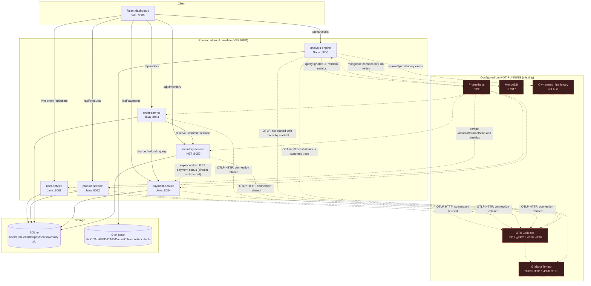
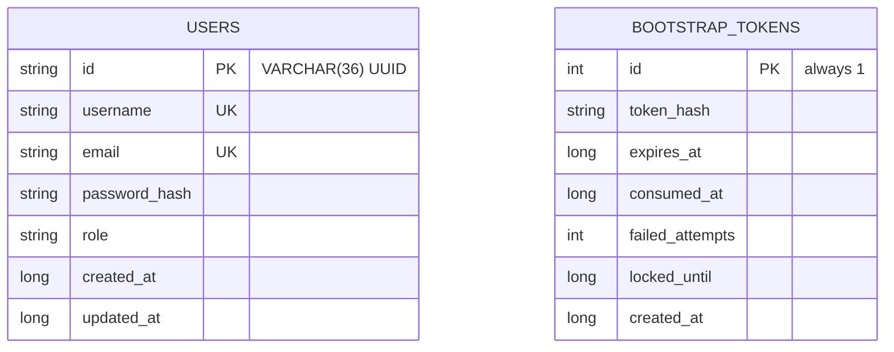
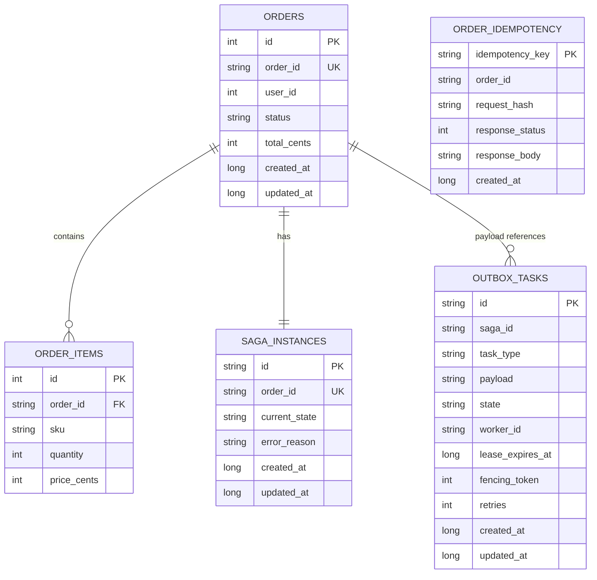
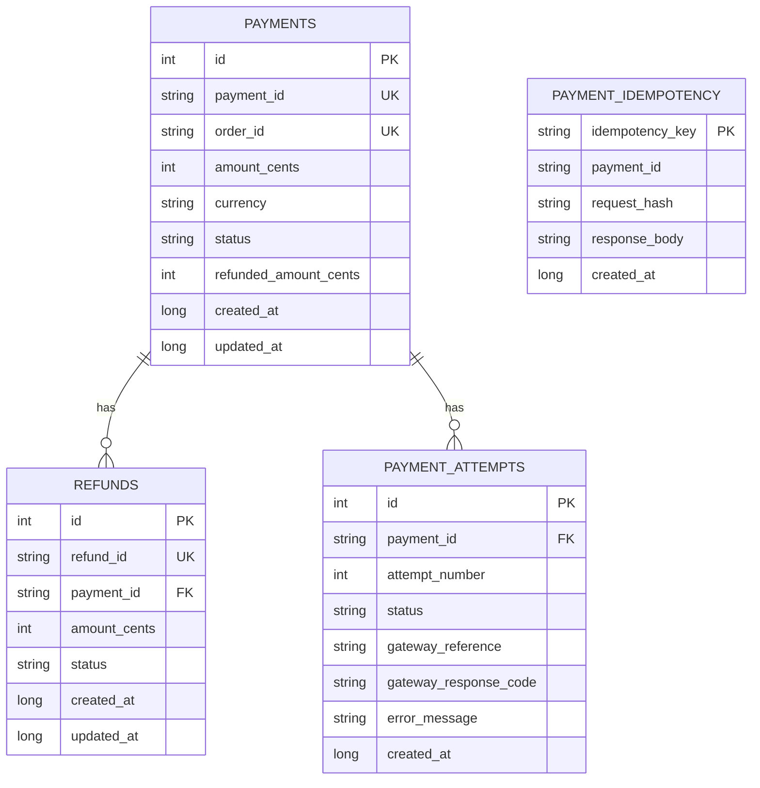
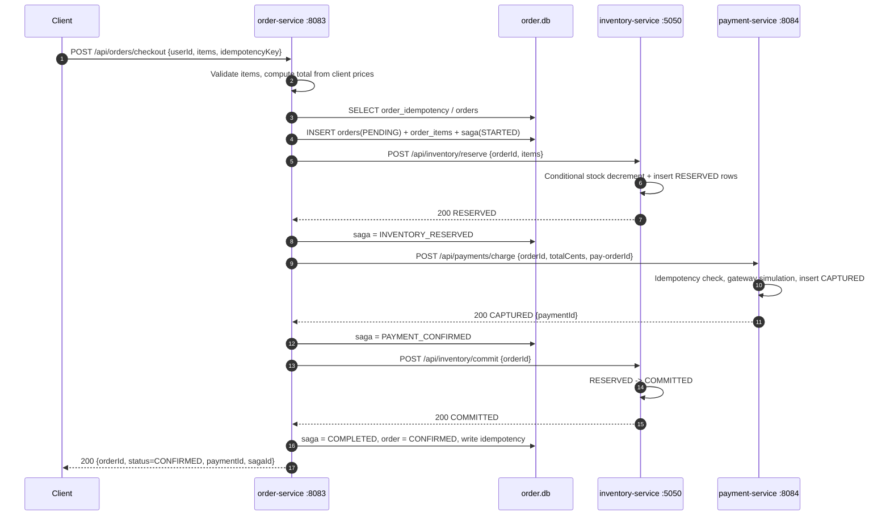
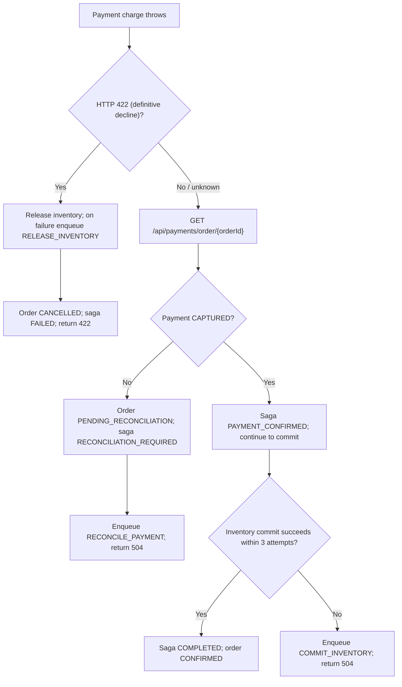
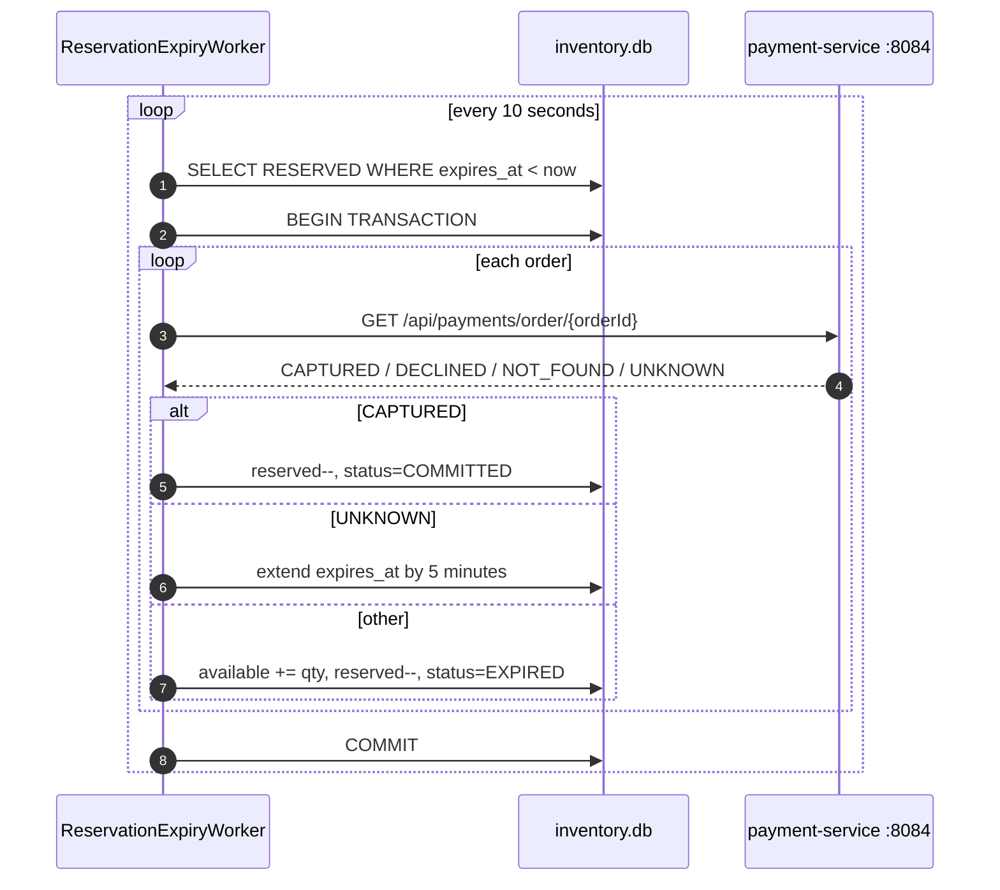
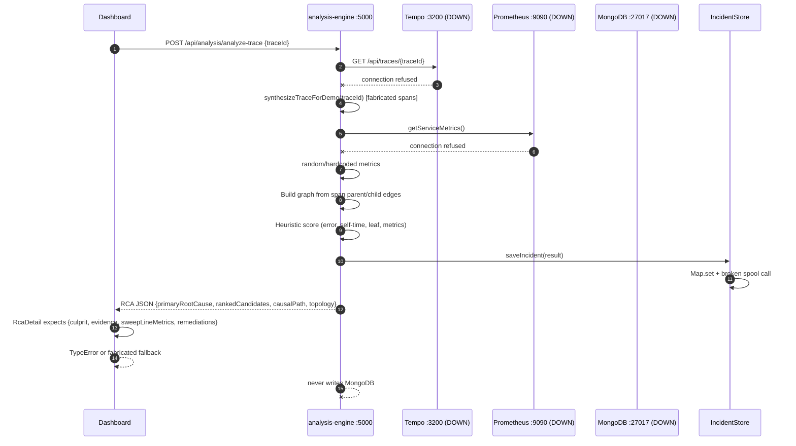
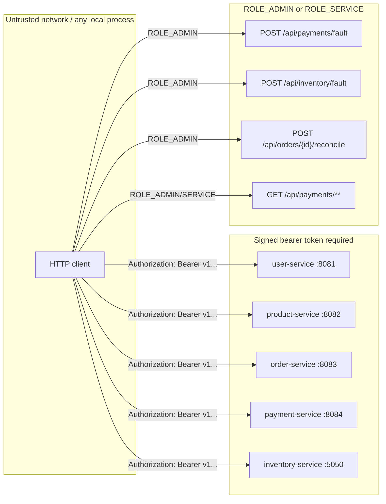

# ARCHITECTURE — CausalOTel

> **Current architecture after remediation (2026-11-13).** The original audit baseline was
> `a10bf0b` (2026-11-11). Sections 1–6 describe the runtime shape and data model, updated where the
> remediation changed them. Sections 7–12 describe the current telemetry, security, frontend,
> operations, and status. The only unresolved finding is **L-04** (native C++ core), which is
> **BLOCKED** by the absence of CMake/C++ tooling. Full finding statuses and evidence are in
> [`AUDIT_REPORT.md`](AUDIT_REPORT.md) §10; run/test context is in
> [`PROJECT_CONTEXT.md`](PROJECT_CONTEXT.md).

## 1. System context

CausalOTel is a local polyglot e-commerce demo with an observability/RCA sidecar:

- **Business plane:** user, product, order, payment, and inventory services.
- **Analysis plane:** a Node.js analysis engine and a React dashboard.
- **Telemetry plane (running):** OpenTelemetry Collector → Tempo for traces; Prometheus for metrics.
- **Persistence:** one SQLite database per business service, plus a durable disk incident spool in the
  analysis engine. MongoDB is not used.

After remediation the business plane, dashboard, and native telemetry plane all run locally. The
analysis engine serves only real Tempo traces and Prometheus metrics; backend failures are explicit
degraded/unavailable states. See §7.

## 2. Runtime topology



**Port summary:** `3000` dashboard, `8081` user, `8082` product, `8083` order, `8084` payment,
`5050` inventory, `5000` analysis. `4317`, `4318`, `4320`, `8889`, `9090`, and `3200` were closed at
the audit baseline.

## 3. Service and API catalog

### 3.1 user-service — Java/Spring Boot, port 8081

| Method | Path | Purpose | Status |
|---|---|---|---|
| GET | `/api/users` | List users | IMPLEMENTED, **broken for UUID rows** (reads `id` as `int`) |
| GET | `/api/users/{id}` | Get user by integer id | IMPLEMENTED, **contract mismatch** with `VARCHAR(36)` schema |
| POST | `/api/users/bootstrap-admin` | One-time admin provisioning with `X-Bootstrap-Token` | IMPLEMENTED |
| GET | `/health/live`, `/health/ready`, `/health` | Health probes | IMPLEMENTED |
| GET | `/actuator/prometheus` | Micrometer metrics | IMPLEMENTED |

Data: `user.db` (`users`, `bootstrap_tokens`). Admin bootstrap generates a 256-bit token, stores only
its SHA-256 hash, writes the raw token to
`%LOCALAPPDATA%\CausalOTel\security\.bootstrap_admin_token`, and deletes the file after successful
consumption. Passwords are BCrypt cost 12.

### 3.2 product-service — Java/Spring Boot, port 8082

| Method | Path | Purpose |
|---|---|---|
| GET | `/api/products` | List catalog |
| GET | `/api/products/{sku}` | Get product by SKU |
| GET | `/health/live`, `/health/ready`, `/health` | Health probes |
| GET | `/actuator/prometheus` | Metrics |

Data: `product.db` (`products`). Flyway V2 seeds four SKUs, including `SKU-LAPTOP-001` and a
zero-stock `SKU-OUT-OF-STOCK-004`.

### 3.3 order-service — Java/Spring Boot, port 8083

| Method | Path | Purpose |
|---|---|---|
| POST | `/api/orders/checkout` | Execute checkout saga |
| POST | `/api/orders/{orderId}/reconcile` | Manually reconcile an indeterminate order |
| GET | `/api/orders` | List orders |
| GET | `/api/orders/{orderId}` | Get order |
| GET | `/api/orders/{orderId}/items` | Get order items |
| GET | `/api/orders/{orderId}/saga` | Get saga state |
| GET | `/api/orders/outbox` | List recent outbox tasks |
| GET | `/health/live`, `/health/ready` | Health probes |
| GET | `/actuator/prometheus` | Metrics |

Data: `order.db` (`orders`, `order_items`, `saga_instances`, `outbox_tasks`, `order_idempotency`).
The checkout request body is `{userId, items:[{productId, sku, quantity, priceCents}],
idempotencyKey}`. **Prices and totals come from the client** (AUDIT_REPORT C-02).

### 3.4 payment-service — Java/Spring Boot, port 8084

| Method | Path | Purpose |
|---|---|---|
| GET | `/api/payments` | List payments |
| GET | `/api/payments/{paymentId}` | Get payment by payment id |
| GET | `/api/payments/order/{orderId}` | Get payment by order id (reconciliation) |
| POST | `/api/payments/charge` | Charge (idempotent) |
| POST | `/api/payments/refund` | Refund with cumulative invariant |
| POST | `/api/payments/fault` | Set simulated latency/fault mode |
| GET | `/api/payments/fault` | Read simulated fault state |
| GET | `/health/live`, `/health/ready` | Health probes |
| GET | `/actuator/prometheus` | Metrics |

Data: `payment.db` (`payments`, `refunds`, `payment_idempotency`, `payment_attempts`, plus
`payments.refunded_amount_cents`). Fault modes: `NORMAL`, `LATENCY`, `DECLINED` (422),
`GATEWAY_TIMEOUT` (504), `GATEWAY_DOWN` (503). Simulation is enabled by default and fails closed when
a `prod`/`production` profile is active.

### 3.5 inventory-service — .NET/ASP.NET Core, port 5050

| Method | Path | Purpose |
|---|---|---|
| GET | `/api/inventory` | List stock items |
| GET | `/api/inventory/{sku}` | Get stock by SKU |
| POST | `/api/inventory/reserve` | Reserve stock for an order |
| POST | `/api/inventory/commit` | Commit a reservation |
| POST | `/api/inventory/release` | Release a reservation |
| POST | `/api/inventory/fault` | Set simulated latency/busy/error |
| GET | `/api/inventory/fault` | Read fault state |
| GET | `/health/live`, `/health/ready`, `/health` | Health probes |
| GET | `/metrics` | OpenTelemetry Prometheus exporter |

Data: `inventory.db` (`stock_items`, `stock_reservations`) created with `EnsureCreated()`, not
migrations. A background `ReservationExpiryWorker` scans expired `RESERVED` rows every 10 seconds and
calls payment-service to decide whether to commit, extend, or expire.

### 3.6 analysis-engine — Node.js/Express, port 5000

| Method | Path | Purpose | Actual behavior |
|---|---|---|---|
| GET | `/health/live` | Liveness | Always UP |
| GET | `/health/ready` | Readiness | **503** unless MongoDB is connected |
| GET | `/metrics` | Prometheus metrics | Process metrics only |
| GET | `/api/analysis` | Baseline contract | Pending spool file count |
| GET | `/api/analysis/incidents` | List incidents | In-memory `Map` only |
| GET | `/api/analysis/incidents/:id` | Incident detail | In-memory `Map` only |
| POST | `/api/analysis/analyze-trace` | Analyze a trace | Tempo fetch or synthetic fallback |
| GET | `/api/analysis/graph` | Dependency graph | **Static** 7-node topology |
| GET | `/api/analysis/metrics` | Service metrics | **Random/hardcoded** |
| POST | `/api/analysis/spool` | Spool incident | Writes disk file; path traversal risk |

### 3.7 dashboard — React/Vite, port 3000

| Route | Component | Data source | Actual behavior |
|---|---|---|---|
| `/` | `Overview.jsx` | static + checkout POST | Static health/KPIs; live checkout button |
| `/services` | `Services.jsx` | static | Every service shown `ONLINE` |
| `/graph` | `DependencyGraph.jsx` | `GET /api/analysis/graph` | Static graph; payment node always red |
| `/traces` | `Traces.jsx` | static mock | Four hardcoded traces |
| `/traces/:traceId` | `TraceDetail.jsx` | `POST /api/analysis/analyze-trace` | Response ignored; hardcoded waterfall |
| `/incidents` | `Incidents.jsx` | `GET /api/analysis/incidents` | Fabricated fallback incidents |
| `/rca`, `/rca/:incidentId` | `RcaDetail.jsx` | `GET /api/analysis/incidents/:id` | Expects an older/different schema |
| `/metrics` | `Metrics.jsx` | `GET /api/analysis/metrics` | Expects array; keeps mock array |
| `/fault-injection` | `FaultInjection.jsx` | fault endpoints | Sends wrong payload shape |
| `/settings` | `Settings.jsx` | static + direct probes | Reports UP on probe failure |

Vite proxies `/api/users`, `/api/products`, `/api/orders`, `/api/payments`, `/api/inventory`, and
`/api/analysis` to the corresponding service.

## 4. Data model

### 4.1 user.db



The controller reads `users.id` with `ResultSet.getInt` and accepts `@PathVariable int id`, which
does not match the UUID column (AUDIT_REPORT M-04).

### 4.2 product.db

`products(id, sku UNIQUE, name, description, price_cents, stock_quantity, created_at, updated_at)`.
Four seed rows are inserted by Flyway V2.

### 4.3 order.db



Order and saga IDs are deterministic: `ord-`/`saga-` plus the first 16 hex characters of
`SHA-256(idempotencyKey)`. The idempotency `request_hash` is
`SHA-256(userId:totalCents:itemCount)`, not a hash of the full item payload (AUDIT_REPORT H-03).

### 4.4 payment.db



`payments.order_id` is unique, so a second successful charge for the same order cannot be inserted.
Refunds enforce `already_refunded + requested <= captured` in a transaction and a conditional update.

### 4.5 inventory.db

`stock_items(product_id PK, sku UNIQUE, available_quantity, reserved_quantity, updated_at)` and
`stock_reservations(id PK, order_id, sku, quantity, status, expires_at, created_at, updated_at)`.
There is **no unique constraint on `(order_id, sku)`**. Reservation uses a conditional SQL decrement:

```sql
UPDATE stock_items
SET AvailableQuantity = AvailableQuantity - ?, ReservedQuantity = ReservedQuantity + ?, UpdatedAt = ?
WHERE Sku = ? AND AvailableQuantity >= ?;
```

The idempotency check happens **before** the transaction begins, and the reservation rows are inserted
after the decrement (AUDIT_REPORT H-04/H-05).

### 4.6 Analysis data

- **Incident store:** `Map<incidentId, incident>` in process memory. Lost on restart.
- **Disk spool:** `${LOCALAPPDATA}/CausalOTel/spool/incidents` (or `SPOOL_DIR`), 500 MB default quota,
  write-to-`.tmp` then rename. The filename embeds the caller-supplied `incidentId` without
  sanitization (AUDIT_REPORT C-01).
- **MongoDB:** `MONGODB_URI` defaults to `mongodb://localhost:27017/causalotel_rca`; Mongoose connects
  only for the readiness check. There are no models, schemas, or writes (AUDIT_REPORT H-11).

## 5. Checkout saga

### 5.1 Happy path



### 5.2 Failure branches



Two background jobs in order-service:

- **`OutboxWorker.processOutboxTasks`** every 5 seconds: claims one `PENDING` task or an expired
  `IN_PROGRESS` task with a fencing token, handles `RELEASE_INVENTORY`, `REFUND_PAYMENT`,
  `COMMIT_INVENTORY`, or `RECONCILE_PAYMENT`, then marks `COMPLETED` or reschedules.
- **`OutboxWorker.recoverStaleSagas`** every 5 seconds: selects sagas in `PAYMENT_CONFIRMED`,
  `INVENTORY_COMMITTING`, `RECONCILIATION_REQUIRED`, `COMPENSATING_INVENTORY`, or
  `COMPENSATING_PAYMENT` whose `updated_at` is older than 5 seconds, then commits, reconciles, or
  releases.

Known defects in this path: client-controlled price (C-02), weak/partial idempotency (H-03),
inventory race (H-04/H-05), swallowed enqueue/state errors (H-06), 5-second stale-saga race (H-07),
no downstream timeouts (H-09), and ineffective outbox backoff (M-01).

### 5.3 Inventory expiry and circular dependency



The HTTP call is made while the SQLite write transaction is open (AUDIT_REPORT H-08). The worker also
creates an inventory → payment runtime dependency, even though the normal checkout path is
order → payment.

## 6. RCA pipeline

### 6.1 Implemented flow



### 6.2 Actual scoring vs README formula

The README describes a weighted score with baseline Z-score, contribution, error origination, and
critical-path terms. The implemented engine uses:

| Signal | Weight | Code behavior |
|---|---:|---|
| Span status `ERROR` or HTTP ≥ 500 | 0.40 | Adds 0.40 |
| Self-time > 2000 ms | 0.35 | Adds 0.35 |
| Self-time > 500 ms and > 60% of span duration | 0.25 | Adds 0.25 |
| Failing leaf/deepest callee | 0.15 | Adds 0.15 |
| Metrics error rate > 10% or p95 > 1000 ms | 0.10 | Adds 0.10 |

Candidates with score > 0.2 are returned; the top candidate becomes `primaryRootCause`. There is no
historical baseline, Z-score, critical-path calculation, or calibration. The README formula is
**PLANNED/NOT IMPLEMENTED**.

### 6.3 Self-time engine

`TempoClient.buildSpanTreeAndSelfTimes` computes each span's children intervals, calls
`computeIntervalUnion(parent, children)`, and stores `selfTimeMs`, `childUnionDurationMs`,
`mergedChildIntervals`, and `timingEngine`.

`cpp_bridge.js` tries these binaries in order:

1. `cpp-core/bin/sweep_line.exe`
2. `cpp-core/build/Release/sweep_line.exe`
3. `cpp-core/build/sweep_line.exe`
4. `cpp-core/build/sweep_line`

If none exists or the process fails/times out (500 ms), it calls the JavaScript
`calculateSweepLine`. At the audit baseline **no binary existed and CMake was not installed**, so
every calculation used `javascript_fallback`. The C++ path is **UNVERIFIED**.


## 7. Observability: current implementation

| Component | Implementation | Runtime state |
|---|---|---|
| OTel Collector | `otelcol-contrib 0.165.0`; OTLP gRPC `4317`, HTTP `4318`; Prometheus exporter `8889`; health `13133` | Running; verified |
| Tempo | `3.1.1`; query `3200`, OTLP `4320`; portable config rendered from `CAUSALOTEL_DATA_ROOT` | Running; verified |
| Prometheus | `3.16.0`; scrape `9090`; scrapes Collector, Java services, inventory, analysis | Running; all targets `UP` |
| Java tracing | Spring Boot 4 `spring-boot-starter-opentelemetry`; Micrometer OTLP export to `4318/v1/traces` | Running; real spans observed |
| Analysis tracing | `node --import ./src/tracer.js`; `serviceName: analysis-engine` | Running; real spans observed |
| .NET tracing | OTel ASP.NET/HTTP instrumentation + OTLP exporter configured | Metrics/health real; OTLP spans not emitted in this build |
| Service metrics | Micrometer/Prometheus on Java; `/metrics` on inventory and analysis | Verified |
| Analysis metrics API | Deterministic PromQL queries; typed 503 on Prometheus failure | Verified; `source: prometheus` |
| Incident persistence | Durable disk spool; atomic writes; restart hydration; quarantine | Verified; `/health/ready` reports `store: disk-spool` |
| Dashboard | Real authenticated APIs for health, traces, RCA, metrics, incidents, faults, graph, settings | Verified; no mock fallback |

### 7.1 Failure behavior

The analysis engine never substitutes synthetic data on the real path:

- Tempo 404 → `404 TRACE_NOT_FOUND`; Tempo outage → `503 TEMPO_UNAVAILABLE`; malformed
  response → `502 TEMPO_INVALID_RESPONSE`.
- Prometheus outage → `503` with an explicit unavailable code.
- The service graph returns an explicit empty graph when Tempo has no traces; it does not
  paint a static topology.
- The optional demo fixture is disabled by default, marked `synthetic: true`, never persisted,
  and rejected by RCA scoring.
- Dashboard pages render an explicit error/unavailable panel when an API fails.

### 7.2 Trace and graph flow

1. Java services and the analysis engine export OTLP spans to the Collector.
2. The Collector batches spans to Tempo and exposes its own metrics to Prometheus.
3. The analysis engine lists recent traces with a window, fetches details with bounded
   concurrency (default 5), and computes self-time and RCA evidence. The trace list can be
   narrowed with exact `service` and `operation` filters, which are converted into escaped
   TraceQL clauses.
4. The graph builder derives service nodes/edges from direct parent/child spans across service
   boundaries. Scheduler (`task ...`) and actuator/health roots are excluded by a Tempo
   `rootName` TraceQL filter and by a defensive client-side check, so the business topology is
   not drowned out by maintenance traffic.
5. Incidents are written atomically to the disk spool before the API reports `persisted: true`.

## 8. Security and trust boundaries



- Tokens are HMAC-SHA256 signed: `v1.<base64url(payload)>.<base64url(hmac)>`.
  The shared secret comes from `AUTH_TOKEN_SECRET` / `auth.token.secret`; the development
  fallback constant is not a production secret.
- Roles: `ROLE_USER`, `ROLE_ADMIN`, `ROLE_SERVICE`.
- Registration always creates `ROLE_USER`. The first admin is created from a one-time bootstrap
  token file; an expired, unconsumed token is regenerated on startup.
- Order reads are scoped to the authenticated user; checkout requires `userId` to match the token
  subject for non-admin/service callers.
- Payment reads and fault control are admin/service only.
- Fault injection is bounded, audited, and can be disabled with
  `causalotel.fault-injection.enabled=false` / `CAUSALOTEL_FAULT_INJECTION_ENABLED=false`.
- Payment simulation defaults off and is only permitted under explicit `demo`, `dev`, or `test`
  profiles; `prod`/`production` aborts. Disabled charge/refund/fault endpoints return `503`.
- Incident IDs are validated against a filename-safe pattern and the resolved spool path must be a
  direct child of the spool root.

## 9. Frontend data wiring

| Page | Request | Behavior |
|---|---|---|
| Login | `POST /api/users/login`, `POST /api/users/register`, `POST /api/users/bootstrap-admin` | Real auth; all routes gated |
| Overview | `GET /api/analysis/services`, incidents, metrics | Real probes; explicit unavailable states |
| Services | `GET /api/analysis/services` | Server-side probe results only |
| DependencyGraph | `GET /api/analysis/graph?window=...` | Real Tempo parent/child topology, cache/window metadata |
| Traces | `GET /api/analysis/traces` | Real Tempo search rows; empty state if none |
| TraceDetail | `GET /api/analysis/traces/:id`, `POST /api/analysis/analyze-trace` | Real span waterfall; RCA action uses the real detail route |
| Incidents | `GET /api/analysis/incidents` | Durable spool incidents; no fabricated fallback |
| RcaDetail | `GET /api/analysis/incidents/:id` | Real incident contract; legacy `/incidents/:id` maps here |
| Metrics | `GET /api/analysis/metrics` | Real `{source, generatedAt, window, services}` object |
| FaultInjection | payment/inventory fault endpoints | Exact backend payloads; admin-only |
| Settings | `GET /api/analysis/services`, `GET /api/analysis/native-core` | Real health and real native build state (`NOT BUILT` when absent) |

## 10. Deployment and scripts

| Script | Behavior |
|---|---|
| `install-observability.ps1` | Downloads pinned Collector/Tempo/Prometheus archives, verifies SHA-256, extracts to `tools/observability` |
| `start-observability.ps1` | Renders Tempo config from `CAUSALOTEL_DATA_ROOT`, starts the stack, waits for readiness |
| `stop-observability.ps1` | Stops recorded observability PIDs and listeners |
| `verify-observability.ps1` | Sends a real OTLP span, verifies Tempo storage and analysis-engine read, verifies Prometheus targets |
| `start-all.ps1` | Rebuilds stale artifacts, checks ports/PIDs, starts observability and seven app processes, waits for readiness, exits nonzero on failure |
| `stop-all.ps1` | Stops recorded PIDs and any listener on application/observability ports |
| `build-all.ps1` | Runs Java `clean verify`, `dotnet test`, Node tests, dashboard tests/build, optional native build; tracks failures and exits nonzero; reports `cpp-core SKIP` when CMake is absent |
| `test-all.ps1` | Isolated 7-suite run with redirected `LOCALAPPDATA`, temp DB paths, live DB/spool fingerprints, nonzero exit on failure |
| `demo-checkout-rca.ps1` | Real auth, catalog price, baseline checkout, admin fault, recovery/reconcile, Tempo trace, persisted RCA, Prometheus targets; fails nonzero on missing telemetry |

## 11. Status matrix

| Component | Status | Notes |
|---|---|---|
| User bootstrap + auth | IMPLEMENTED / VERIFIED | Signed tokens, roles, one-time admin bootstrap, expired-token regeneration |
| User read API | IMPLEMENTED / VERIFIED | UUID `TEXT` end to end |
| Product catalog | IMPLEMENTED / VERIFIED | Authenticated reads, authoritative prices |
| Order checkout happy path | IMPLEMENTED / VERIFIED | Server pricing, canonical idempotency, transactional saga |
| Order compensation/reconciliation | IMPLEMENTED / VERIFIED | Leases, backoff, refund escalation, late-commit handling |
| Payment charge/refund | IMPLEMENTED / VERIFIED | Striped locks, simulation gating |
| Inventory reservation | IMPLEMENTED / VERIFIED | Unique `(OrderId, Sku)`, request hash, state machine |
| Inventory expiry | IMPLEMENTED / VERIFIED | HTTP resolution before write transactions |
| Fault injection backend/frontend | IMPLEMENTED / VERIFIED | Admin-only, bounded, exact payloads |
| Tarjan graph algorithm | IMPLEMENTED / VERIFIED | Unit tests |
| Runtime graph endpoint | IMPLEMENTED / VERIFIED | Tempo-derived, filtered, bounded concurrency |
| JS sweep-line | IMPLEMENTED / VERIFIED | Tested fallback |
| C++ sweep-line | **BLOCKED** | No CMake/compiler; explicit `NOT BUILT` status |
| Tempo integration | IMPLEMENTED / VERIFIED | Real spans, typed errors |
| Prometheus integration | IMPLEMENTED / VERIFIED | Real metrics, typed errors |
| Incident persistence | IMPLEMENTED / VERIFIED | Durable disk spool |
| RCA heuristic | IMPLEMENTED / VERIFIED | Real traces only; synthetic rejected |
| Dashboard incidents/RCA | IMPLEMENTED / VERIFIED | Real contracts |
| Dashboard traces | IMPLEMENTED / VERIFIED | Real Tempo data |
| Dashboard metrics | IMPLEMENTED / VERIFIED | Real Prometheus data |
| OTel export | IMPLEMENTED / VERIFIED | Java + analysis; inventory metrics only |
| Authentication/authorization | IMPLEMENTED / VERIFIED | All business/fault APIs |
| MongoDB | NOT USED | Removed from readiness/storage path |

## 12. Architectural risks and limitations

1. **Local demo, not production.** SQLite, local processes, no TLS, no horizontal scaling, no
   secrets manager, no deployment manifests.
2. **Payment is simulated.** No real transactions; simulation is profile-gated and off by default.
3. **Native C++ path is unverified.** The JS fallback is active; L-04 is blocked by the missing
   toolchain.
4. **Inventory is not traced in Tempo.** It is visible to Prometheus and health probes but does not
   emit OTLP spans in this build.
5. **Long-lived local databases may contain historical rows** from earlier runs; they are not
   fixtures.
6. **The dashboard is an operator demo**, not a hardened multi-tenant console.
7. **The analysis engine is a single process.** Its cache and in-memory incident index are local;
   the disk spool is the durable source of truth.
